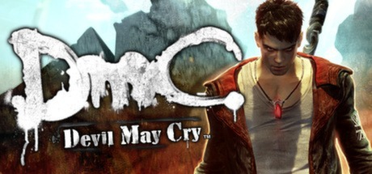

**DmC: Devil May Cry is the Ninja Theory reimagining of Devil May Cry following a younger Dante navigating a world where demons control society. Features Angel and Demon pull mechanics for traversal and combat, with tight style-ranking combat.**

---

## 📖 About

DmC: Devil May Cry is the Ninja Theory reimagining of Devil May Cry following a younger Dante navigating a world where demons control society. Features Angel and Demon pull mechanics for traversal and combat, with tight style-ranking combat.

## ⚠️ Problems Without Trainer

| Problem | Status |
|---------|--------|
| **Style Ranking** — Getting SSS ranks requires mastering weapon switching and dodge chains | ✅ Solved |
| **Son of Sparda Difficulty** — Unlocked after normal completion; significantly harder | ✅ Solved |
| **Vergil Boss Fights** — Dante Must Die mode Vergil encounters are extremely punishing | ✅ Solved |
| **Karma System** — Stylish kills required to unlock full move set on current playthrough | ✅ Solved |

## ✅ Solution

The **DmC: Devil May Cry Trainer** solves all these issues by giving you complete control over the game.

## 🎯 Full Feature List

- Unlimited Resources
- God Mode / Invincibility
- Instant Skill Cooldown
- One-Hit Kill
- Freeze Game Timer
- Unlock All Items & Achievements
- Custom Speed Multiplier
- Save State Anywhere

## 🚀 Quick Start

1. **Disable Windows Defender** temporarily (trainer may trigger false positive)
2. Download the trainer from the button above
3. Launch DmC: Devil May Cry
4. Run the trainer as Administrator
5. Activate desired cheats with hotkeys

## 💎 Free vs Paid

| Feature | Free | Pro |
|---------|------|-----|
| Basic God Mode | ✅ | ✅ |
| Unlimited Resources | ✅ | ✅ |
| All Advanced Cheats | ❌ | ✅ |
| Auto-Updates | ❌ | ✅ |
| Priority Support | ❌ | ✅ |

## 💻 Requirements

- Windows 10/11 (64-bit)
- DmC: Devil May Cry (any version)
- .NET Framework 4.8+
- DirectX 11+

## 🍎 macOS

macOS users can use our alternative tool:

## ⚖️ Legal

This trainer is for educational and single-player use only. Use responsibly.

---

